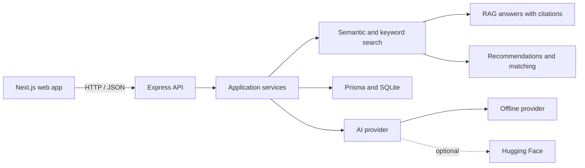
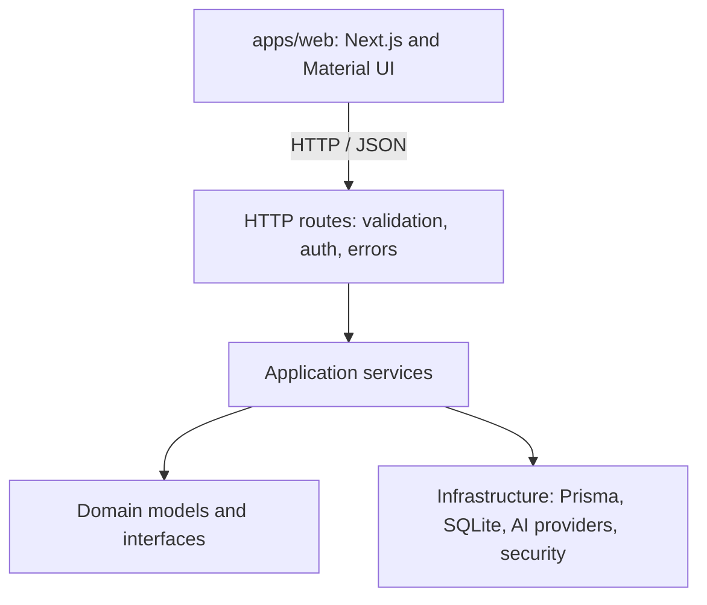

# Community Space

An AI-powered platform to discover communities, events, resources, and collaborators. Organizers can publish content, understand engagement, and answer questions grounded in community knowledge.


**Works locally without paid services or API keys:** the demo uses SQLite and an offline AI provider by default, with optional Hugging Face models.



---

## Table of contents

1. [What it does](#what-it-does)
2. [Quick start](#quick-start)
3. [Demo accounts](#demo-accounts)
4. [Architecture](#architecture)
5. [Tech stack and why](#tech-stack-and-why)
6. [How the AI works](#how-the-ai-works)
7. [Documentation index](#documentation-index)
8. [Project structure](#project-structure)
9. [Scripts](#scripts)
10. [Troubleshooting](#troubleshooting)

---

## What it does

Every requirement from the problem statement, and where it lives:

| Requirement | Implementation | Where to see it |
|---|---|---|
| Searchable profiles with skills, interests, expertise | Profile model + member directory with skill/availability filters | `/people` → *Member directory* |
| Recommend events, communities, resources, collaborators by intent | Intent vector = request + profile + activity history, blended and matched against the index | `/` → type an intent, press **Recommend** |
| Organizers publish events, announcements, resources in structured form | Validated publishing forms; content is summarised and indexed on save | `/events`, `/communities`, `/resources` |
| AI summarises long announcements and descriptions | `SummarizationService` runs on every create/update over 280 characters | AI summary badge on cards; live playground on `/resources` |
| Semantic search with natural-language questions | Hybrid vector + keyword retrieval across 7 entity types | `/search` |
| Intelligent teammate/collaborator matching | Explainable 3-signal scoring (semantic, skill coverage, availability) | `/people` → *Find teammates* |
| Moderation / reporting for misleading, duplicate, inappropriate content | Report flow + automated triage with near-duplicate detection | `/moderation` |

**Advanced directions**, all implemented:

- **RAG knowledge assistant** — retrieve → ground → answer → cite (`/assistant`)
- **Semantic recommendation and matching** — one shared retrieval engine drives both
- **AI-generated event/resource summaries** — automatic on publish
- **Conversation-based discovery** — chat interface with suggested follow-up questions
- **Organizer analytics** — engagement over time, top events, skill supply, and *frequently requested information* extracted from assistant questions, including content gaps (`/analytics`)

---

## Quick start

**Requirements:** Node.js 20 or newer. Nothing else — no Docker, no database server, no API keys.

```bash
# 1. install dependencies for both apps
npm install

# 2. create the SQLite database, seed demo data and build the vector index
npm run db:setup

# 3. start the API (port 4000) and the web app (port 3000) together
npm run dev
```

Open **http://localhost:3000**.

> `npm run db:setup` prints the demo accounts and the number of indexed entities when it finishes.

### Optional: enable Hugging Face models

The app works fully offline. To use hosted models instead:

1. Create a free token at <https://huggingface.co/settings/tokens>
2. Put it in `apps/api/.env`:
   ```env
   HUGGINGFACE_API_KEY=hf_xxxxxxxxxxxxxxxx
   ```
3. Restart and re-index: `npm run db:reset`

Models used: `sentence-transformers/all-MiniLM-L6-v2` (embeddings), `facebook/bart-large-cnn` (summaries), `meta-llama/Llama-3.2-3B-Instruct` (assistant answers).

If Hugging Face is slow, rate-limited or unreachable, the app **automatically falls back** to the offline provider — the demo never breaks.

---

## Demo accounts

Password for all accounts: `password123`

| Email | Role | Use it to show |
|---|---|---|
| `aarav@communityspace.dev` | ORGANIZER | Publishing events, resources, announcements + Organizer Analytics |
| `meera@communityspace.dev` | ORGANIZER | ML/NLP profile — good for matching demos |
| `rohan@communityspace.dev` | MEMBER | Student looking for a hackathon team — sees neither Analytics nor Moderation |
| `sara@communityspace.dev` | ADMIN | Resolving moderation reports — the only role that sees the queue |

The sign-in dialog lists these accounts — click one to auto-fill it.

### Who sees what

| Capability | Signed out | MEMBER | ORGANIZER | ADMIN |
|---|---|---|---|---|
| Browse, search, ask the assistant | ✅ | ✅ | ✅ | ✅ |
| RSVP, join communities, report content | — | ✅ | ✅ | ✅ |
| Publish content + pre-publish AI quality check | — | — | ✅ | ✅ |
| Organizer analytics | — | — | ✅ | ✅ |
| Moderation queue | — | — | — | ✅ |

Enforced twice: `auth.requireRole(...)` on the API (the real boundary — restricted
calls return `401`/`403`) and a single `ROUTE_ROLES` map on the web client that
drives both the sidebar filter and the page guard, so restricted pages never
appear in the navigation.

---

## Architecture

Layered ("clean") architecture. Dependencies point **inwards only**: HTTP knows about services, services know about interfaces, and nothing in the core knows about Express, Prisma or Hugging Face.



Full explanation with SOLID/DRY examples: **[docs/ARCHITECTURE.md](./docs/ARCHITECTURE.md)** and **[docs/SOLID-AND-DRY.md](./docs/SOLID-AND-DRY.md)**.

---

## Tech stack and why

| Layer | Choice | Why this one |
|---|---|---|
| Frontend | **Next.js 15** (App Router) + **React 19** | File-based routing, one command to run, industry standard |
| UI | **Material UI 6** + custom theme | Complete accessible component set; design tokens defined once, light/dark built in |
| Charts | **MUI X Charts** | Same design language as the rest of the UI |
| Backend | **Node.js + Express 4 + TypeScript** | Same language as the frontend — one mental model, no Python required |
| Validation | **Zod** | Schema validation that also produces TypeScript types |
| Database | **SQLite via Prisma 6** | Zero setup, a single file, fully typed queries; swappable to Postgres by changing one line |
| Auth | **JWT + bcrypt** | Stateless, standard, easy to explain |
| Vector store | **Embeddings table + in-memory cosine** | No external vector DB needed at this scale; the interface allows swapping in pgvector/Qdrant later |
| AI | **Hugging Face Inference API + offline fallback** | Free tier, and a demo that cannot fail |

**No Python anywhere** — the entire codebase is TypeScript.

---

## How the AI works

### 1. Indexing (writes)
When any content is created or updated:

```
content → build searchable document (title + body + context)
        → split into overlapping ~700-char chunks
        → embed each chunk → store vector in EmbeddingRecord
```

Seven entity types are indexed: `EVENT`, `RESOURCE`, `ANNOUNCEMENT`, `POST`, `COMMUNITY`, `PROFILE`, `PROJECT`.

### 2. Retrieval (reads)
Search, recommendations, matching and the assistant all use **one** ranking function:

```
score = 0.75 × cosine(query_vector, chunk_vector)   ← meaning
      + 0.25 × keyword_overlap(query, chunk)        ← exact terms
```

The lexical term keeps precise matches ("Docker", "CKA", "GSoC") competitive even when the embedding model is generic. The best chunk per entity wins, so one long announcement cannot flood the results.

### 3. Generation (RAG assistant)
```
question → retrieve top-6 chunks → build grounded prompt
         → LLM (or offline extractive composer) → answer + citations
         → log question for organizer analytics
```
Answers show their sources with relevance scores and a `grounded` / `low confidence` badge, so nothing is taken on trust.

### 4. Matching
```
score = 0.55 × semantic similarity (brief ↔ profile)
      + 0.35 × required-skill coverage
      + 0.10 × availability + experience
```
Every candidate card lists the reasons and the missing skills — no black box.

### 5. Moderation triage
Three explainable checks, combined into a priority score:
- **Near-duplicate detection** — `0.5 × cosine + 0.5 × lexical containment` against everything already indexed
- **Spam patterns** — promotional phrases, link density, all-caps
- **Flagged-term lexicon**

Thresholds were calibrated against the seed corpus (exact re-post ≈ 0.58, reworded ≈ 0.46, unrelated ≈ 0.12). A human always makes the final decision.

---

## Documentation index

| Document | Contents |
|---|---|
| [docs/ARCHITECTURE.md](./docs/ARCHITECTURE.md) | Layers, request lifecycle, data model, design patterns used |
| [docs/SOLID-AND-DRY.md](./docs/SOLID-AND-DRY.md) | Each principle with the exact file and line of code that demonstrates it |
| [docs/API.md](./docs/API.md) | Every endpoint with request/response examples |
| [docs/AI-FEATURES.md](./docs/AI-FEATURES.md) | Deep dive into embeddings, RAG, ranking and the fallback strategy |
| [docs/DEMO-SCRIPT.md](./docs/DEMO-SCRIPT.md) | A 7-minute presentation walkthrough with what to say |

---

## Project structure

```
community-space/
├── apps/
│   ├── api/                        Express + TypeScript backend
│   │   ├── prisma/
│   │   │   ├── schema.prisma       data model
│   │   │   └── seed.ts             demo data + index build
│   │   └── src/
│   │       ├── config/env.ts       validated configuration (only reader of process.env)
│   │       ├── core/               errors, logger, JSON, text utils, vector maths
│   │       ├── domain/
│   │       │   ├── entities/       framework-free models
│   │       │   ├── repositories/   repository interfaces
│   │       │   └── services/       AI provider interfaces
│   │       ├── application/services/   business logic
│   │       ├── infrastructure/
│   │       │   ├── persistence/    Prisma repositories + mappers
│   │       │   ├── ai/             HF provider, local provider, decorators, factory
│   │       │   └── security/       bcrypt + JWT
│   │       ├── interfaces/http/    routes, middleware
│   │       ├── container.ts        composition root
│   │       ├── app.ts              Express app factory
│   │       └── server.ts           entry point
│   └── web/                        Next.js frontend
│       └── src/
│           ├── app/                one folder per page
│           ├── components/         AppShell, Providers, shared UI kit
│           ├── lib/api.ts          typed API client
│           └── theme/theme.ts      design tokens
└── docs/                           documentation
```

---

## Scripts

Run from the repository root:

| Command | What it does |
|---|---|
| `npm install` | Install both apps |
| `npm run db:setup` | Create DB, seed demo data, build the vector index |
| `npm run db:reset` | Wipe and re-seed (use after changing the AI provider) |
| `npm run dev` | Start API + web together |
| `npm run dev:api` | API only, on port 4000 |
| `npm run dev:web` | Web only, on port 3000 |
| `npm run build` | Production build of both apps |
| `npm run typecheck` | Type-check both apps |

---

## Troubleshooting

**Port already in use** — change `PORT` in `apps/api/.env` and `NEXT_PUBLIC_API_URL` in `apps/web/.env.local`.

**Search returns nothing** — the index is empty. Run `npm run db:setup`, or sign in as an organizer and `POST /api/ai/reindex`.

**`prisma generate` fails with "Could not resolve @prisma/client"** — run `npm install` from the repository root (not from `apps/api`), so the CLI and client are installed together.

**Changed the AI provider and results look odd** — embeddings from different models are not comparable. Run `npm run db:reset` to rebuild the index with the new model. (The search layer also filters out mismatched vector dimensions automatically.)

**Everything is slow on first request** — with a Hugging Face token the first call can take ~20s while the model wakes up. Subsequent calls are fast, and a timeout falls back to the offline provider.
